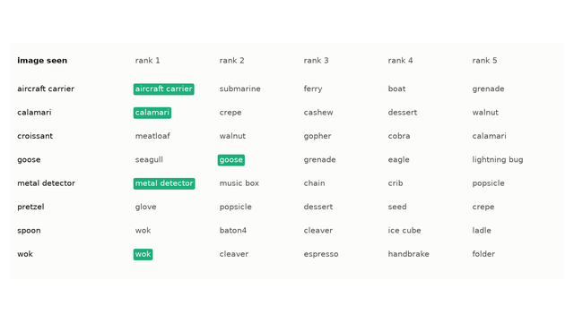
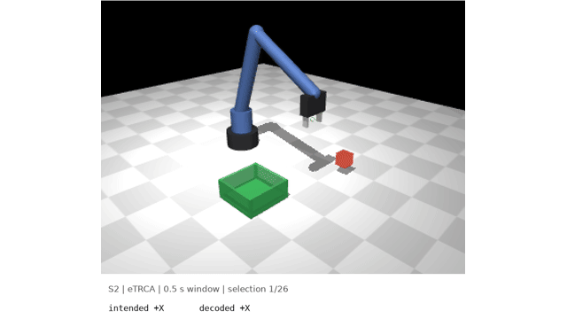
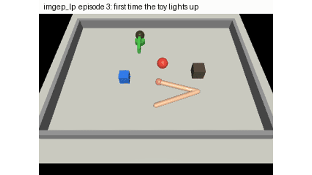
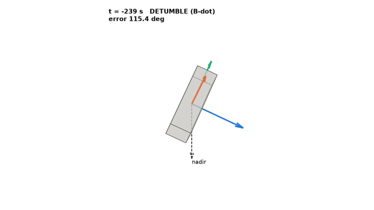
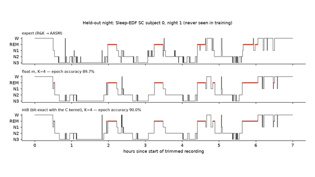
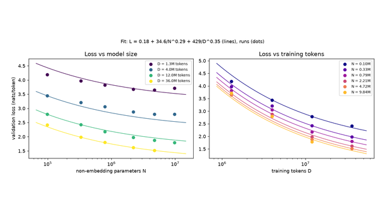
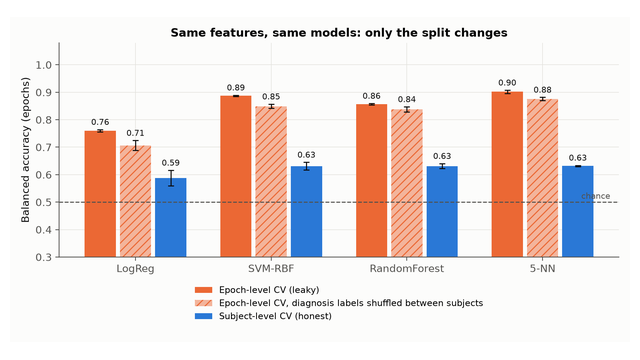
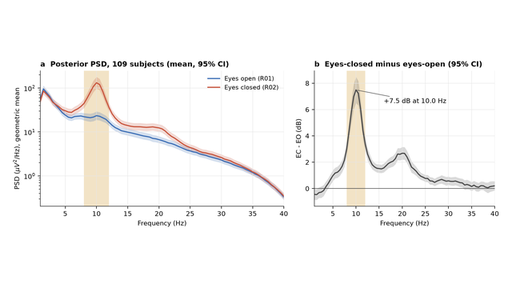
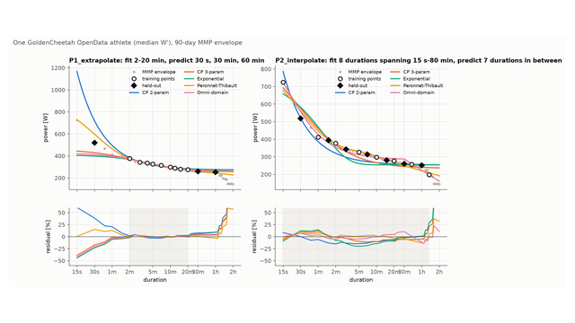

I'm Tommaso. I build [Aretē](https://arete.info), EEG glasses, and in between I take apart signals, sensors and models to see what actually holds up.

<!-- TODO(Tommaso): replace the line above with your own sentence -->

<table>
<tr>
<td width="33%" valign="top"> <a href="https://github.com/Tommycode3/glimpse-eeg"><code>glimpse-eeg</code></a> Which of 200 unseen images was a person looking at, read from their EEG. Right first guess 25% of the time; chance is 0.5%.</td>
<td width="33%" valign="top"> <a href="https://github.com/Tommycode3/flicker2grasp"><code>flicker2grasp</code></a> Real held-out SSVEP EEG trials drive a MuJoCo arm through pick-and-place. TRCA on 0.5 s windows finishes 97% of episodes.</td>
<td width="33%" valign="top"> <a href="https://github.com/Tommycode3/cribworld"><code>cribworld</code></a> A simulated arm that starts from nothing and learns by playing. Motor babbling, curiosity and goal babbling compared, negative results included.</td>
</tr>
<tr>
<td valign="top"> <a href="https://github.com/Tommycode3/tumble-to-point"><code>tumble-to-point</code></a> A 3U CubeSat from a 10 deg/s tumble to nadir pointing: B-dot, MEKF with gyro bias, reaction wheels, Monte Carlo.</td>
<td valign="top"> <a href="https://github.com/Tommycode3/hypnogram-on-a-chip"><code>hypnogram-on-a-chip</code></a> Five-stage sleep scoring from one EEG channel in 11 KiB of int8 C, bit-exact with Python. Cohen's κ 0.78 on held-out subjects.</td>
<td valign="top"> <a href="https://github.com/Tommycode3/pocket-chinchilla"><code>pocket-chinchilla</code></a> 23 transformers trained from scratch on TinyStories, a Chinchilla scaling-law fit, and a 215-line C program that runs them in int8.</td>
</tr>
<tr>
<td valign="top"> <a href="https://github.com/Tommycode3/adhd-eeg-reality-check"><code>adhd-eeg-reality-check</code></a> Where the 95–99% EEG ADHD classifiers come from: split by epoch and you get 0.90, split by subject and you get 0.63.</td>
<td valign="top"> <a href="https://github.com/Tommycode3/eeg-alpha-bench"><code>eeg-alpha-bench</code></a> Does your EEG device see alpha? An eyes-closed benchmark, validated on 109 subjects: +7.5 dB at 10 Hz.</td>
<td valign="top"> <a href="https://github.com/Tommycode3/powercurve-bench"><code>powercurve-bench</code></a> Five power-duration models tested on efforts they never saw, across 874 cyclists, plus a Kalman fitness-fatigue model.</td>
</tr>
</table>

**Models and learning** 
[ui-reward](https://github.com/Tommycode3/ui-reward) a 0.5B model learns to write HTML from rewards computed in a headless browser, and the reward hacks it found on the way

**Brain and behaviour** 
[silent-emg](https://github.com/Tommycode3/silent-emg) silently mouthed dates and times decoded from face and neck EMG ·
[eeg-repro](https://github.com/Tommycode3/eeg-repro) EEGNet, ShallowConvNet and DeepConvNet rerun on BCI IV 2a, paper numbers next to ours ·
[taulapse](https://github.com/Tommycode3/taulapse) ex-Gaussian and drift-diffusion models of reaction-time variability ·
[jitai-lab](https://github.com/Tommycode3/jitai-lab) design and analysis of micro-randomized trials

**Body and sport** 
[fractal-threshold](https://github.com/Tommycode3/fractal-threshold) aerobic thresholds from HRV with DFA-α1 ·
[cruxtrace](https://github.com/Tommycode3/cruxtrace) climbing sessions from a wrist IMU ·
[liftsense](https://github.com/Tommycode3/liftsense) gym rep counting and form checks ·
[bodyledger](https://github.com/Tommycode3/bodyledger) local-first store for wearable data, with an MCP server ·
[fitbit-air-lab](https://github.com/Tommycode3/fitbit-air-lab) BLE tools for the Fitbit Air

**Hardware and firmware** 
[scriba-pendant](https://github.com/Tommycode3/scriba-pendant) all-day transcription pendant on nRF54L15 ·
[lossless-dac](https://github.com/Tommycode3/lossless-dac) balanced headphone amp with ultralow-noise rails ·
[ir-parrot](https://github.com/Tommycode3/ir-parrot) learn and replay IR remotes on Zephyr ·
[cyd-lab](https://github.com/Tommycode3/cyd-lab) three ESP32 display firmwares ·
[jlcfind](https://github.com/Tommycode3/jlcfind) resolve BOMs to JLCPCB parts from the terminal

**Apps and tools** 
[quiete](https://github.com/Tommycode3/quiete) typographic Android launcher ·
[volante-ios](https://github.com/Tommycode3/volante-ios) podcasts and voice notes from steering-wheel buttons ·
[crosscheck-a2a](https://github.com/Tommycode3/crosscheck-a2a) security auditor for A2A agent cards ·
[igforge](https://github.com/Tommycode3/igforge) git log to Instagram posts ·
[bambu2resin](https://github.com/Tommycode3/bambu2resin) Bambu 3MF projects to resin printers ·
[wifi-doctor](https://github.com/Tommycode3/wifi-doctor) offline Wi-Fi diagnostics for macOS
